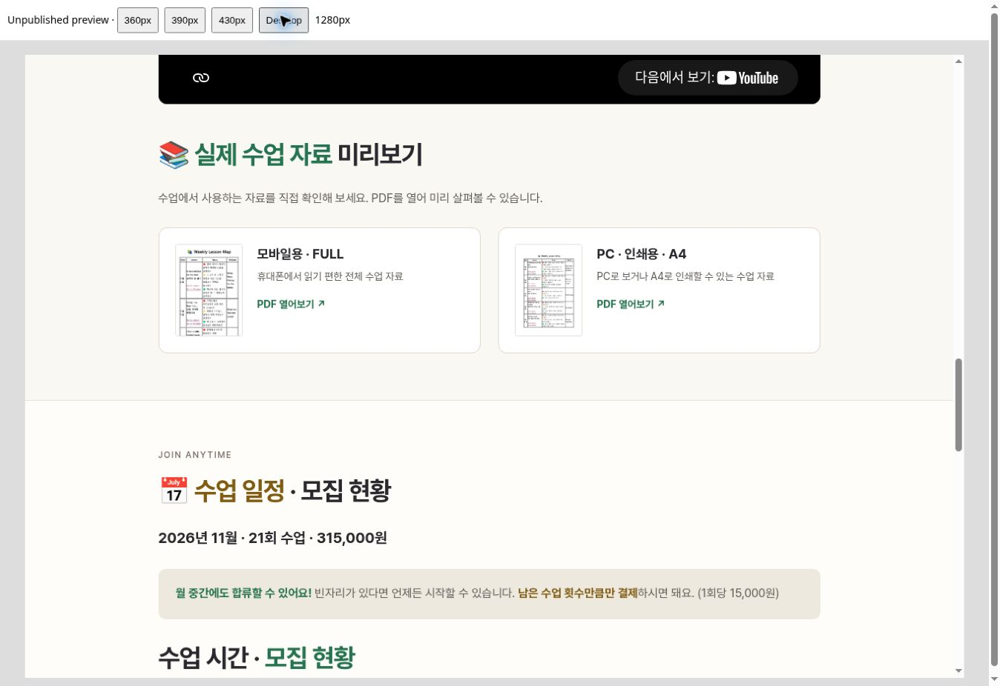
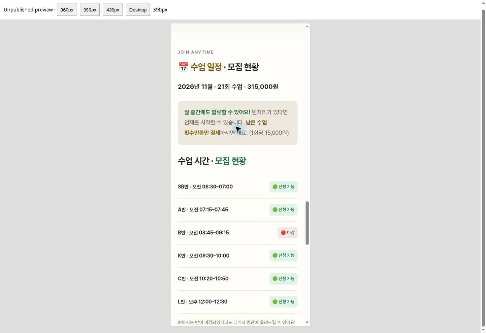

# Homepage refinement preview

Unpublished changes for review. The live GitHub Pages branch has not been updated.

- Keep the compact charcoal opening and all class explanations.
- Use readable ink colors on light sections; retain chalk colors on charcoal.
- Simplify repeated boxes, mission examples and consultation steps.
- Put class times and availability before the smaller calendar.
- Keep only FULL for mobile and A4 for PC/printing, with real page thumbnails.
- Restore editor access to the new introduction, links and enrollment note.
- Render current data in the editor preview and preserve saved colors.

## Desktop sample materials

## Mobile timetable

## Validation

Browser inspection at 360, 390, 430 and 1280px frame widths, with no horizontal overflow. Navigation shortcuts, six class rows, price, calendar, YouTube embed and two PDF links were checked. Original paragraph content was compared against the current main branch and preserved. Both PDF and thumbnail files were validated.

Seventeen isolated editor checks passed, including editing the new elements, saved color persistence, readable derived ink colors, dynamic preview data and a simulated two-file publish. Tests used fixture responses and a dummy token; they did not publish to GitHub or use a real personal token. New-upload transfers and playback inside the sandboxed admin preview were not exercised.
