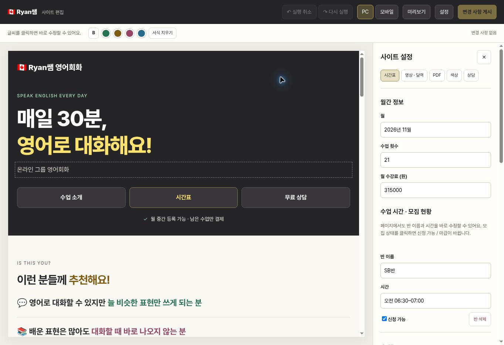

# Visual editor upgrade

Ready for review; not deployed.

The editor displays the actual homepage. Click a complete heading or paragraph to edit it, select words to apply bold or chalk colors, and use undo/redo or PC/mobile preview. Class names, times, PDF titles, descriptions, and the consultation button can be edited directly. Click availability to toggle it. Calendar, video, PDF, palette and contact settings remain available in the side panel.

The homepage removes all occurrences of “소규모” and the heading and paragraph explaining why partners rotate. The explanation of the actual breakout-room process remains.

## Verification

25 isolated browser checks passed. Coverage includes complete-paragraph edits, undo/redo, formatting and clearing inherited formatting, inert markup sanitization, direct class/PDF/contact edits, readable custom colors, preview mode, preserved settings/upload controls, conflict detection, and an atomic simulated publish including an uploaded file. Manual browser checks covered typing, undo, PC/mobile preview and settings layout. JavaScript syntax and Git whitespace checks passed.

Recreate isolated fixtures with `python tests/build_visual_editor_fixture.py`, serve `dist/`, and open `editor-test.html`. GitHub responses in the fixture are mocked; tests never use a real token or publish to the repository. The editor uses a video poster linking to YouTube inside its sandbox; the public homepage keeps its embedded player. Unsaved edits and upload selections remain in the current tab until published. Live GitHub authorization and real uploads need the owner's token and were not exercised.

Publishing creates one commit for text, schedule and uploads. The branch only moves if the source files still match the loaded version and no concurrent commit has advanced the branch. Tokens stay in the tab's password input and are never persisted.
